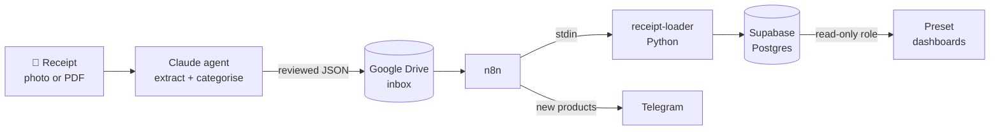
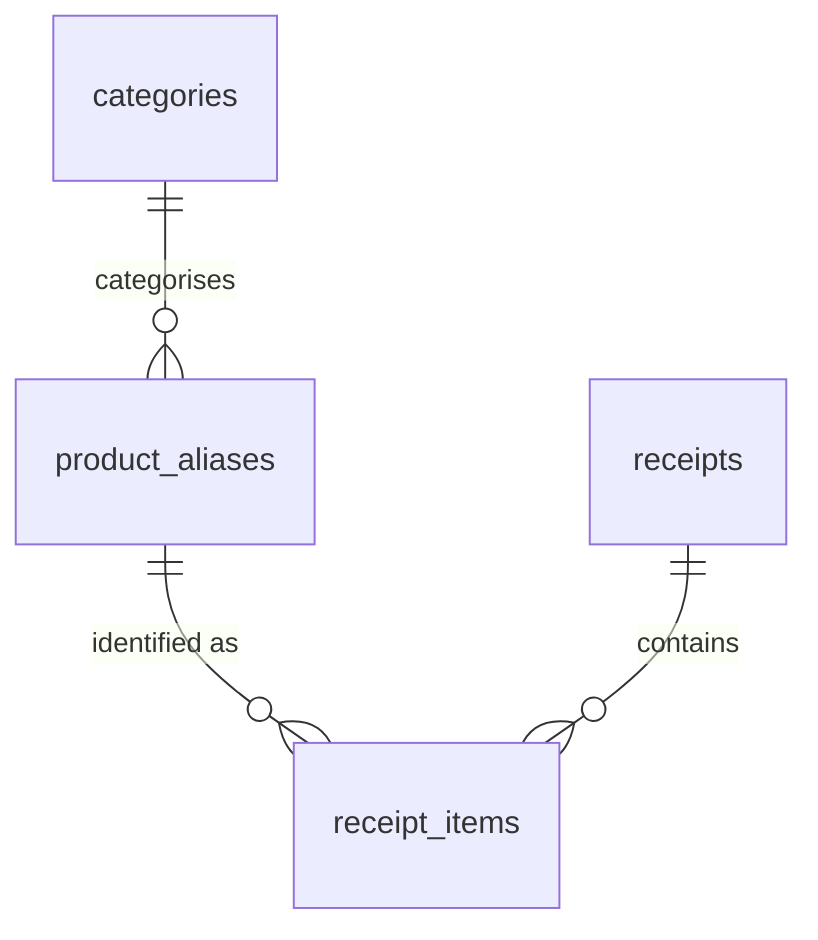

# Grocery Tracker

An end-to-end data pipeline that turns German supermarket receipts (photos or PDFs) into a queryable spending database and BI dashboards.

**Receipt photo or PDF → Claude extracts and categorises → n8n orchestrates → Python validates and loads → Postgres → Superset dashboards**


---

## Why

Supermarket receipts hold detailed data (every product, price, discount and timestamp) that usually ends up in the bin. I wanted to know where my grocery money actually goes: which stores, which categories, how often, and how much discounts really save.

German receipts make this harder than it sounds: cryptic abbreviations (`TAV.OGS`), decimal commas, items sold by weight, item-level *and* basket-level coupons, and a different layout at every chain. The project is built around handling that mess reliably.

## How it works



1. **Extract:** a receipt photo or PDF goes to a Claude agent running a [detailed extraction prompt](docs/extraction-prompt.md). Claude returns structured JSON with a category for every item, and flags anything uncertain instead of guessing. After a quick review in chat, it saves the file to a Google Drive inbox.
2. **Orchestrate:** an [n8n workflow](n8n/) polls the inbox, passes each file to the loader, sends a Telegram message listing products it hasn't seen before, and moves the file to `processed/`.
3. **Load:** [`receipt-loader`](src/receipt-loader) validates the JSON with Pydantic, normalises store names, skips receipts it has already loaded, and writes everything to Postgres in one transaction.
4. **Curate:** new products get a human-readable name once in `product_aliases`. Every later purchase of the same product at the same store is then named automatically.
5. **Analyse:** Preset (managed Apache Superset) reads from Postgres through a read-only role.

More detail is in [docs/architecture.md](docs/architecture.md).

## Highlights

- **Safe to re-run.** Receipt IDs are built from the date, store and time (`20260115-rewe-183045`), so processing the same file twice is a no-op.
- **Flags instead of guessing.** Uncertain categories become *Uncategorized* (ID 12), and every guess is listed in `warnings`. Extraction is never silently wrong.
- **Discounts modelled properly.** List price, amount paid, a per-item discount flag and basket-level coupons are stored separately, so spending can be analysed before or after discounts.
- **Product normalisation.** A `(raw_name, store)` alias table maps cryptic receipt text to readable names and categories.
- **Simple, testable loader.** It's a plain command-line tool (JSON in, JSON out) that's tested without n8n or a database, with a `--dry-run` mode.
- **Least privilege.** The BI tool connects with a `SELECT`-only Postgres role; no secrets are in the repo.

## Tech stack

| Layer | Tool |
|-------|------|
| Extraction | Claude agent with a Google Drive connector |
| Orchestration | n8n, self-hosted in Docker |
| Load | Python 3.13 · Pydantic v2 · psycopg 3 (async) · uv |
| Database | Supabase (Postgres) · Supabase CLI migrations |
| Notifications | Telegram bot |
| BI | Preset (managed Apache Superset) |
| Testing | pytest |

## Data model



Four tables: `receipts` (one per trip), `receipt_items` (one per line), `product_aliases` (one per product per store) and `categories`. The full column reference is in [docs/database-schema.md](docs/database-schema.md).

## Dashboards

**Store Activity** (Preset) shows total trips, stores visited, busiest weekday, trips this month vs last, a daily visit heatmap and visits per store and weekday.

<!-- Screenshots (generated from demo data) will go here: docs/images/ -->

## Getting started

### Prerequisites

- Docker Desktop
- [uv](https://docs.astral.sh/uv/) and Python 3.13 (only needed to run the tests locally)
- A Supabase project, the [Supabase CLI](https://supabase.com/docs/guides/cli), a Google Cloud OAuth client for Drive, and a Telegram bot

### Setup

```bash
# 1. Configure secrets
cp .env.example .env          # then fill in your values

# 2. Create the database schema
set -a && source .env && set +a
supabase link --project-ref "$SUPABASE_PROJECT_REF"
supabase db push              # applies supabase/migrations/
# then run supabase/seed.sql in the Supabase SQL editor to add the categories

# 3. Start n8n (builds the image with receipt-loader inside)
docker compose up -d --build  # n8n on http://localhost:5678
```

4. In n8n, import the workflows from [`n8n/workflows/`](n8n/workflows/) and fill in the placeholders. [n8n/README.md](n8n/README.md) has the steps.
5. Set up a Claude agent with [docs/extraction-prompt.md](docs/extraction-prompt.md) as its instructions and give it a Google Drive connector.

### Try the loader without a database

```bash
uv run --package receipt-loader receipt-loader --dry-run < receipt.json
```

## Tests

```bash
uv run --package receipt-loader pytest src/receipt-loader/tests
```

38 tests cover store normalisation, schema validation, the command-line flow (bad JSON, validation errors, dry run, total check) and the database logic (duplicate skip, alias reuse), using a fake database connection.

## Project structure

```
├── docs/                    # Architecture, schema, extraction prompt, OAuth runbook
├── n8n/workflows/           # Exported n8n workflows (placeholders for IDs)
├── src/receipt-loader/      # Python package: validate JSON → load into Postgres
│   ├── receipt_loader/
│   │   ├── main.py          #   CLI entry point (stdin → stdout)
│   │   ├── models/          #   Pydantic models
│   │   ├── config/          #   Store-name normalisation
│   │   └── db/              #   Postgres access
│   └── tests/
├── supabase/                # Migrations, seed data, example queries
├── Dockerfile               # n8n image + uv + receipt-loader
└── docker-compose.yml
```

## Roadmap

- [ ] Telegram alert when a receipt's items don't add up to its total
- [ ] n8n error-handler workflow
- [ ] NocoDB UI for naming products
- [ ] Spending Overview and Product Insights dashboards

## License

[MIT](LICENSE)
