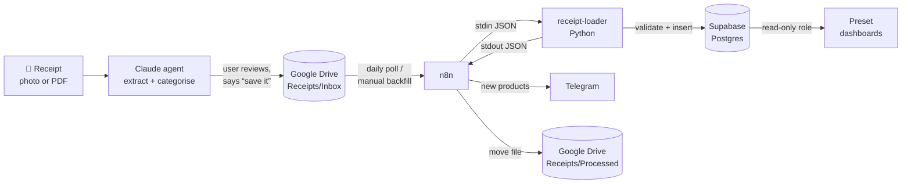

# Architecture

## Data flow

### 1. Extraction (Claude agent)

Receipts are uploaded to a Claude agent that has the [extraction prompt](extraction-prompt.md) as its instructions and a Google Drive connector. A receipt can be a phone photo (JPG, PNG, HEIC) or a PDF, either scanned or digital, such as an e-receipt from a store app.

Claude returns one JSON object per receipt. Every item gets a category, prices are converted from German decimal commas, and anything uncertain goes into a `warnings` array. The user reviews the JSON in chat and corrects it if needed. Only after an explicit "save it" does Claude write `{receipt_id}.json` to `Receipts/Inbox`.

Extraction is deliberately **human-in-the-loop**. Photos are often blurry or crumpled and PDF layouts vary between chains, and a 30-second review is cheaper than cleaning up bad rows later. The prompt also refuses to save when a discount can't be matched to an item.

### 2. Orchestration (n8n)

n8n runs locally in Docker. Two workflows ([`n8n/`](../n8n/)):

| Workflow | Trigger | Purpose |
|----------|---------|---------|
| `single-receipt-ingest-polling` | Google Drive trigger, daily at 22:00 | Normal operation: process new files in the inbox |
| `receipt-backfill` | Manual | Process everything in the inbox in one run (initial import) |

Both follow the same steps: download the file → write it to a temp file → pipe it into `receipt-loader` → parse its JSON output → send a Telegram message if new products appeared → move the file to `Receipts/Processed`.

### 3. Loading (`receipt-loader`)

A small Python package ([`src/receipt-loader`](../src/receipt-loader)) baked into the n8n Docker image. It works as a plain command-line tool, JSON in on stdin and JSON out on stdout, so n8n only needs to run a command and read the result.

1. **Validate** the input with Pydantic: required fields, allowed units, ISO dates and times. The store name is normalised against a list of known stores, and unknown stores are rejected.
2. **Skip duplicates.** If the `receipt_id` already exists, return `{"status": "skipped"}`.
3. **Insert** in one transaction: the receipt header, then for each item an upsert into `product_aliases` and an insert into `receipt_items`.
4. **Report** the products seen for the first time (`new_aliases`). If the item totals don't add up to the receipt total (more than €0.01 apart), it sets `sanity_warning` but still saves the receipt, because the human check already happened upstream.

`--dry-run` validates the input and prints a summary without touching the database.

### 4. Curation

New products arrive with the exact receipt text (`BIO VOLLMILCH 3,8%`) and the category Claude picked. The Telegram message lists them so they can be given a readable `common_name` (and brand, notes, or a corrected category) in `product_aliases`. That way, every later purchase of the same product at the same store is already named.

### 5. Dashboards (Preset)

Preset (managed Apache Superset) connects straight to Supabase using a dedicated **read-only Postgres role** (`SELECT` only, no write access). A breach on the BI side can expose data but never change or delete it.

Current dashboards: **Store Activity** (trip counts, busiest weekday, month-over-month trend, visit heatmap, visits per store and weekday) and **Spending Overview** (monthly spend by store and by category, category share). Screenshots with sample data: [dashboards.md](dashboards.md).

## Tech stack

| Layer | Tool | Why |
|-------|------|-----|
| Extraction | Claude agent with a Google Drive connector | Reads both messy photos and PDFs; the chat UI gives a free review step |
| Inbox | Google Drive | Easy to upload to from a phone; the folders act as a simple queue |
| Orchestration | n8n (self-hosted, Docker) | Visual workflows, built-in Google Drive and Telegram nodes, runs on a laptop |
| Load | Python 3.13, Pydantic, psycopg 3 (async), uv | Strict validation, small dependency footprint, reproducible environment |
| Database | Supabase (Postgres, free tier) | Managed Postgres, migrations via the Supabase CLI |
| Notifications | Telegram bot | Push notifications on a phone without cluttering email |
| BI | Preset (managed Superset, free tier) | SQL-native dashboards straight on Postgres |

## Key design decisions

| Decision | Rationale |
|----------|-----------|
| **Deterministic `receipt_id`** (`{YYYYMMDD}-{store}-{HHMMSS}`) as the primary key and the file name | Re-running a file is safe: duplicates are detected and skipped. Any Drive file can be traced to its database row by name. |
| **`product_aliases` table** keyed on `(raw_name, store)` | Receipt text is cryptic and differs between stores. The raw text stays as printed for the record, and a readable name and category are added once per product. |
| **Category ID 12 = "Uncategorized"** instead of a guess | "A wrong category is worse than an honest I don't know." Uncertain items are flagged for review instead of silently miscategorised. |
| **List prices and discounts kept separate** | `unit_price` is always the printed price; `total_price` is what was paid; `is_discounted` flags coupons. Basket-level coupons go to `receipts.store_wide_discount`, so spending can be analysed with or without discounts. |
| **Loader as a stdin/stdout command-line tool** | Easy to test without n8n, easy to call from any orchestrator, and output n8n can read without extra work. |
| **Python baked into a custom n8n image** | One container and no separate service to run. `uv sync --frozen` keeps dependencies pinned. |
| **Read-only database role for BI** | Least privilege for a third-party SaaS. |

## Secrets

No secrets are in the repo. `.env` is git-ignored; [`.env.example`](../.env.example) lists every variable.

- `SUPABASE_DB_URL` is passed into the n8n container as an environment variable and read by `receipt-loader`.
- Google Drive (OAuth) and Telegram credentials live in n8n's encrypted credential store. See [google-drive-oauth.md](google-drive-oauth.md).
- Preset connects with its own read-only role and password, configured in Preset.

## Roadmap

- [ ] Telegram alert when `sanity_warning` is set
- [ ] n8n error-handler workflow (alert on any failed execution)
- [ ] Scheduled keep-alive query so the free-tier Supabase project doesn't pause
- [ ] NocoDB as a friendlier UI for naming products
- [ ] Product Insights dashboard (top items, most-bought, discounted items)
