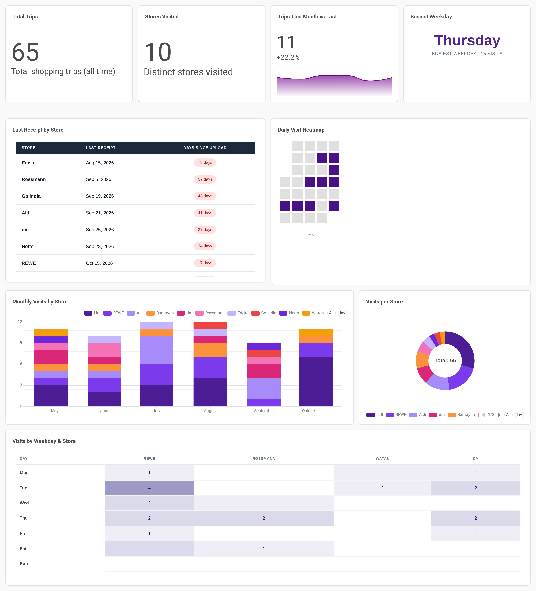
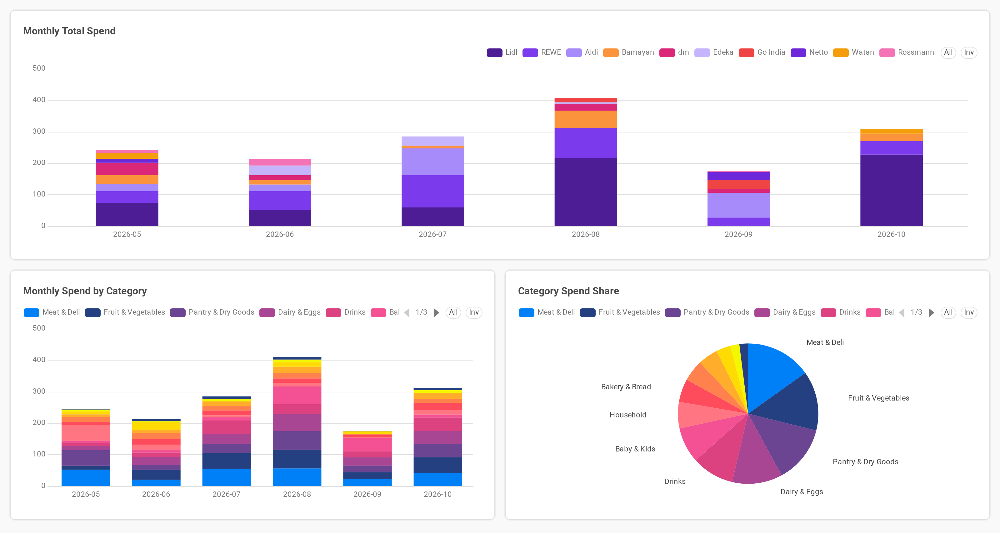

# Dashboards

Two dashboards in Preset (managed Apache Superset), reading straight from Postgres through a read-only role.

> **Sample data.** The screenshots below show **fictional data**: 65 receipts (May–October 2026) created with [`scripts/generate_demo_data.py`](../scripts/generate_demo_data.py) and loaded through the real `receipt-loader` into a separate demo database. No real purchases are shown.

## Store Activity

Where and when shopping happens.



| Chart | What it shows |
|-------|---------------|
| Total Trips · Stores Visited | Headline counts across all receipts |
| Trips This Month vs Last | Latest month's trip count with the change from the previous month and a trend line |
| Busiest Weekday | The weekday with the most trips |
| Last Receipt by Store | Days since each store was last visited, colour-coded by how long ago |
| Daily Visit Heatmap | Shopping days over the last 30 days |
| Monthly Visits by Store · Visits per Store | Store mix over time and overall |
| Visits by Weekday & Store | Which days each store tends to be visited |

## Spending Overview

Where the money goes.



| Chart | What it shows |
|-------|---------------|
| Monthly Total Spend | Spend per month, split by store |
| Monthly Spend by Category | Spend per month, split by category |
| Category Spend Share | Share of total spend per category |

## Recreating the sample data

```bash
# 1. Generate the fictional receipts (same output every run)
uv run --package receipt-loader python scripts/generate_demo_data.py --out demo_data

# 2. Load them into any Postgres that has the schema (supabase/migrations + seed.sql)
for f in demo_data/*.json; do
  SUPABASE_DB_URL="postgresql://…" uv run --package receipt-loader receipt-loader < "$f"
done
```

Options: `--start`, `--end` (date range) and `--seed` (a different set of receipts).
