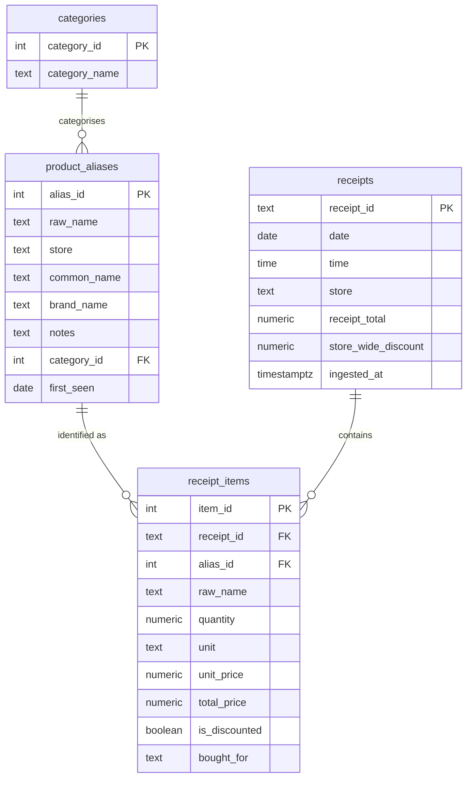

# Database Schema

Supabase (Postgres).

- Migrations: [`supabase/migrations/`](../supabase/migrations/)
- Seed data (categories): [`supabase/seed.sql`](../supabase/seed.sql)
- Tooling and example queries: [`supabase/README.md`](../supabase/README.md)

## Entity relationship diagram



## `categories`

Lookup table for spending categories. It's seeded once, and rows can be added later.

| Column | Type | Notes |
|--------|------|-------|
| `category_id` | `SERIAL` | Primary key |
| `category_name` | `TEXT NOT NULL UNIQUE` | Display name |

Seeded categories: 1 = Meat & Deli, 2 = Dairy & Eggs, 3 = Bakery & Bread, 4 = Fruit & Vegetables, 5 = Drinks, 6 = Snacks & Sweets, 7 = Pantry & Dry Goods, 8 = Frozen, 9 = Household, 10 = Personal Care, 11 = Other, **12 = Uncategorized** (used by the extraction step when it isn't confident), 13 = Ready To Eat Meals, 14 = Baby & Kids.

## `product_aliases`

Maps `(raw_name, store)` to a human-readable name and category. There's one row per unique product per store, created automatically the first time a product appears on a receipt.

| Column | Type | Notes |
|--------|------|-------|
| `alias_id` | `SERIAL` | Primary key |
| `raw_name` | `TEXT NOT NULL` | Exact text from the receipt, e.g. `BIO VOLLMILCH 3,8%` |
| `store` | `TEXT NOT NULL` | Normalised store name, e.g. `REWE` |
| `common_name` | `TEXT` | Readable name, filled in during curation |
| `brand_name` | `TEXT` | Brand, if relevant |
| `notes` | `TEXT` | Free text, e.g. `Bio`, `Freilandhaltung` |
| `category_id` | `INT` | FK → `categories`; set from the extraction step's guess, or 12 if it wasn't confident |
| `first_seen` | `DATE NOT NULL` | Defaults to today |

`UNIQUE (raw_name, store)`, with a matching index.

## `receipts`

Header table: one row per shopping trip.

| Column | Type | Notes |
|--------|------|-------|
| `receipt_id` | `TEXT` | Primary key, `{YYYYMMDD}-{store_lowercase}-{HHMMSS}`. Also the JSON file name. |
| `date` | `DATE NOT NULL` | Purchase date |
| `time` | `TIME NOT NULL` | Purchase time |
| `store` | `TEXT NOT NULL` | Normalised store name |
| `receipt_total` | `NUMERIC(10,2) NOT NULL` | Amount actually paid (the `SUMME` line) |
| `store_wide_discount` | `NUMERIC(10,2) NOT NULL` | Basket-level coupons that can't be assigned to one item. Default `0`. `sum(items.total_price) − store_wide_discount = receipt_total` |
| `ingested_at` | `TIMESTAMPTZ NOT NULL` | Defaults to `NOW()` |

Indexed on `date`. The loader checks `receipt_id` before inserting, so processing the same file twice is a no-op.

## `receipt_items`

Detail table: one row per line item.

| Column | Type | Notes |
|--------|------|-------|
| `item_id` | `SERIAL` | Primary key |
| `receipt_id` | `TEXT NOT NULL` | FK → `receipts` (`ON DELETE CASCADE`) |
| `alias_id` | `INT NOT NULL` | FK → `product_aliases` |
| `raw_name` | `TEXT NOT NULL` | Receipt text, kept for the historical record |
| `quantity` | `NUMERIC(10,3) NOT NULL` | Decimal for weighed items |
| `unit` | `TEXT NOT NULL` | `CHECK` one of `Stück`, `kg`, `g`, `L`, `ml`, `Pack` |
| `unit_price` | `NUMERIC(10,2) NOT NULL` | Printed list price per unit; never adjusted for discounts |
| `total_price` | `NUMERIC(10,2) NOT NULL` | Amount paid for the line, after any item discount |
| `is_discounted` | `BOOLEAN NOT NULL` | `true` if a coupon or promotion applied. Default `false` |
| `bought_for` | `TEXT` | Optional tag for who in the household the item was for |

Indexed on `receipt_id` and `alias_id`.

## Example: monthly spend by category

Item prices are stored before basket-level discounts, so this query spreads `store_wide_discount` across a receipt's items in proportion to their price:

```sql
SELECT
  DATE_TRUNC('month', r.date) AS month,
  c.category_name,
  SUM(ri.total_price)
    - SUM(ri.total_price / s.subtotal * r.store_wide_discount) AS actual_spend
FROM receipt_items ri
JOIN receipts r ON r.receipt_id = ri.receipt_id
JOIN (
  SELECT receipt_id, SUM(total_price) AS subtotal
  FROM receipt_items GROUP BY receipt_id
) s ON s.receipt_id = ri.receipt_id
JOIN product_aliases pa ON pa.alias_id = ri.alias_id
LEFT JOIN categories c  ON c.category_id = pa.category_id
GROUP BY 1, 2
ORDER BY 1 DESC, 3 DESC;
```

More queries are in [`supabase/README.md`](../supabase/README.md).
